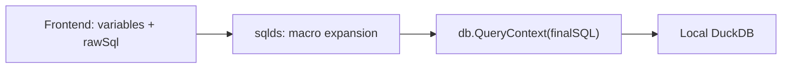

# Quack Query Remote Routing

## Goal

When the user fills in **Quack Query** (remote server address), queries must not hit the local DuckDB catalog directly. Instead, each final SQL string is sent remotely via:

```sql
FROM quack_query('quack:<address>', '<escaped user sql>', disable_ssl => true);
```

When the field is empty, behavior stays unchanged.

Authentication stays out of scope: users configure `CREATE SECRET ... TYPE quack` in existing **Init SQL** (per [DuckDB Quack docs](https://duckdb.org/docs/current/quack/overview.html)).

## Why backend-only, at the DB layer

Query flow today:



- Frontend wrapping would miss backend macros (`$__timeFilter`, `$__timeFrom`, etc.).
- sqlds `QueryMutator` runs **before** macro expansion ([sqlds `handleQuery`](https://github.com/grafana/sqlds/blob/v3.4.2/datasource.go#L140-L155)), so it is the wrong hook.

**Correct hook:** wrap `driver.Conn.QueryContext` on the `*sql.DB` returned from [`Connect()`](pkg/plugin/duckdb_driver.go). sqlds calls `QueryContext` only after `Interpolate()`, so macros are already expanded. Boot/init SQL uses `ExecContext` inside the DuckDB connector callback and is **not** wrapped (local client setup only).

## Implementation (4 focused tasks)

### 1. Plumb the setting through config

Mirror the existing `initSql` pattern:

| Layer | File | Change |
|-------|------|--------|
| TS types | [`src/types.ts`](src/types.ts) | Add `quackQuery?: string` to `DuckDBDataSourceOptions` |
| Config UI | [`src/components/ConfigEditor.tsx`](src/components/ConfigEditor.tsx) | Add optional `InlineField` labeled **Quack Query** with short tooltip (remote Quack server address, e.g. `remote.com:9494`) |
| Go model | [`pkg/models/settings.go`](pkg/models/settings.go) | Add `QuackQuery string \`json:"quackQuery"\`` |

No frontend query changes needed.

### 2. Add SQL escaping + `quack_query` builder (new small Go file)

Create [`pkg/plugin/quack_query.go`](pkg/plugin/quack_query.go) with:

```go
// Escape single quotes per SQL string literal rules.
func quoteSQLString(s string) string {
    return "'" + strings.ReplaceAll(s, "'", "''") + "'"
}

// Prefix quack: unless user already supplied quack: / quack://
func normalizeQuackURI(addr string) string { ... }

func buildQuackQuery(addr, sql string) string {
    uri := quoteSQLString(normalizeQuackURI(addr))
    query := quoteSQLString(sql)
    return fmt.Sprintf("FROM quack_query(%s, %s, disable_ssl => true)", uri, query)
}
```

**Escaping rules (intentionally minimal):**
- Wrap the user SQL in single-quoted string literals.
- Escape `'` as `''` (same approach already used for MotherDuck `ATTACH` in [`duckdb_driver.go`](pkg/plugin/duckdb_driver.go#L114)).
- Apply the same escaping to the URI argument.
- Skip re-wrapping if the SQL already starts with `from quack_query(` (case-insensitive guard against double-wrap).

Add [`pkg/plugin/quack_query_test.go`](pkg/plugin/quack_query_test.go) covering:
- Simple query (`SELECT 1`)
- Embedded single quotes (`it's`, `''`)
- Multiline SQL
- URI normalization (`host:9494` vs `quack:host:9494`)
- Double-wrap guard

### 3. Wrap DuckDB connector when setting is set

Create [`pkg/plugin/quack_conn.go`](pkg/plugin/quack_conn.go) — a thin wrapper around `driver.Connector` / `driver.Conn` that overrides only `QueryContext`:

```go
type quackConnector struct {
    inner driver.Connector
    addr  string
}

func (c *quackConnector) Connect(ctx context.Context) (driver.Conn, error) {
    conn, err := c.inner.Connect(ctx)
    return &quackConn{Conn: conn, addr: c.addr}, err
}

func (c *quackConn) QueryContext(ctx context.Context, query string, args []driver.NamedValue) (driver.Rows, error) {
    return c.Conn.QueryContext(ctx, buildQuackQuery(c.addr, query), args)
}
```

Wire in [`pkg/plugin/duckdb_driver.go`](pkg/plugin/duckdb_driver.go) `Connect()`:

```go
connector, err := duckdb.NewConnector(path, bootCallback)
if strings.TrimSpace(config.QuackQuery) != "" {
    connector = &quackConnector{inner: connector, addr: config.QuackQuery}
}
db := sql.OpenDB(connector)
```

When Quack Query is enabled, also append to boot queries (before user `initSql`):

```sql
INSTALL quack; LOAD quack;
```

This ensures the local DuckDB client can call `quack_query`. Users still use **Init SQL** for `CREATE SECRET` if the remote server requires a token.

### 4. Verify existing behavior unchanged

- Run `go test ./pkg/plugin/...` — existing tests in [`pkg/plugin/datasource_test.go`](pkg/plugin/datasource_test.go) use empty `quackQuery` and must keep passing.
- New unit tests validate escaping independently (no live Quack server required).

## What is explicitly out of scope

- Separate Quack token field (per your preference: Init SQL only)
- Configurable `disable_ssl` (hardcoded `true` as requested)
- E2E test against a real Quack server
- Wrapping connect-time boot/init `ExecContext` SQL (must stay local)

## Files touched (estimated ~80-100 new lines)

- Modify: [`src/types.ts`](src/types.ts), [`src/components/ConfigEditor.tsx`](src/components/ConfigEditor.tsx), [`pkg/models/settings.go`](pkg/models/settings.go), [`pkg/plugin/duckdb_driver.go`](pkg/plugin/duckdb_driver.go)
- Add: [`pkg/plugin/quack_query.go`](pkg/plugin/quack_query.go), [`pkg/plugin/quack_query_test.go`](pkg/plugin/quack_query_test.go), [`pkg/plugin/quack_conn.go`](pkg/plugin/quack_conn.go)
